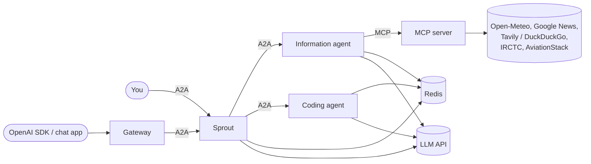
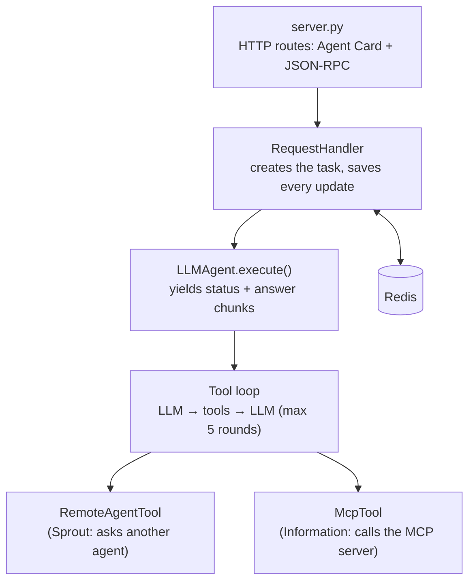
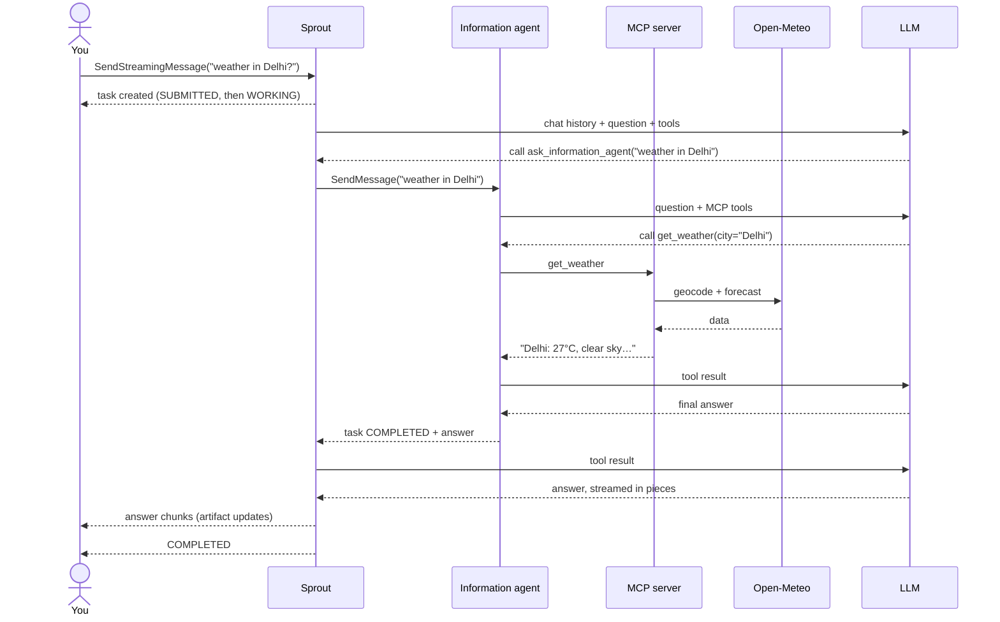
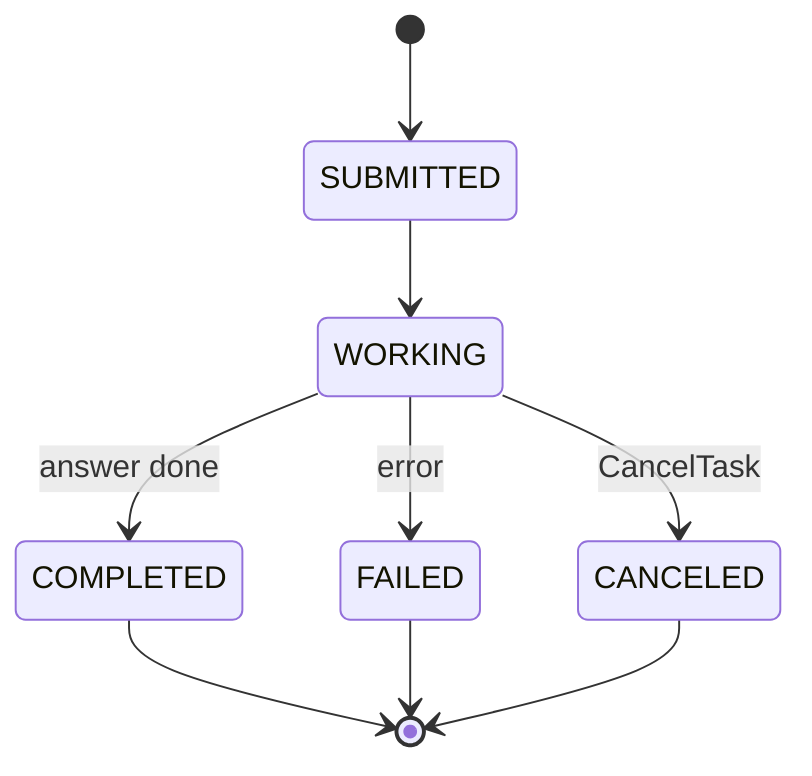
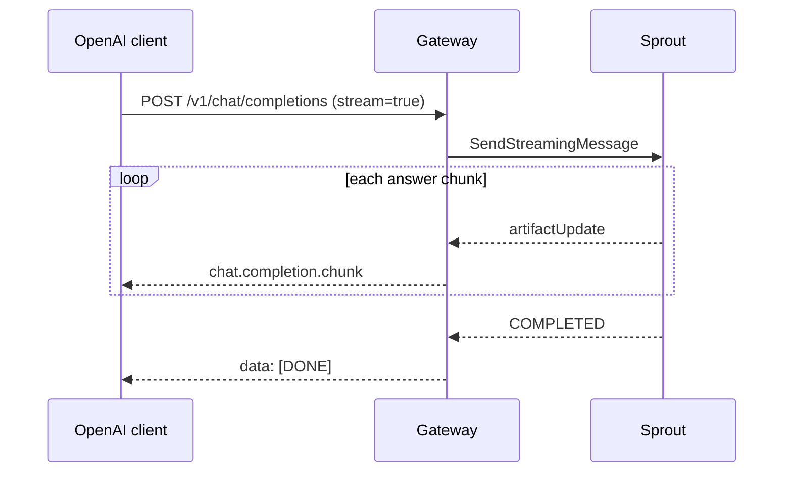

# Architecture

## The big picture

You only ever talk to **Sprout**. Sprout is a friendly chat agent. When it needs help, it asks another agent over **A2A** (the Agent-to-Agent protocol).

- **Sprout**: chats with you and decides who to ask.
- **Information agent**: looks up live facts using tools from the MCP server.
- **Coding agent**: writes and explains code. It never runs code.
- **MCP server**: wraps outside APIs (weather, news, search, trains, flights) as tools.
- **Gateway**: lets any OpenAI client (SDK, chat app) talk to Sprout.
- **Redis**: remembers tasks and conversations.

Every box is the same Docker image started with a different command, for example `python -m a2a_system sprout`.

## How agents find each other

Each agent publishes an **Agent Card** at `/.well-known/agent-card.json`. The card holds its name, what it can do (its skills) and how to call it.

On its first request, Sprout reads the cards of the other agents and turns each one into a **tool** for its LLM: `ask_information_agent` and `ask_coding_agent`. From then on, the LLM decides when to delegate, the same way it decides to call any other function.

## Inside one agent

All three agents are built from the same layers:

- **server.py** receives the request and checks the `A2A-Version: 1.0` header.
- **RequestHandler** creates a task, runs the agent and saves each update to Redis.
- **LLMAgent** loads your chat history, runs the LLM, calls tools when asked, and streams the answer back piece by piece.

## A request, step by step

You ask Sprout: *"What's the weather in Delhi?"*

Two details:

- Sprout **streams** its answer to you. The call from Sprout to the Information agent waits for the whole answer instead.
- The Information agent doesn't see your chat history. Sprout rewrites follow-ups ("and tomorrow?") into full questions before it asks.

## Task lifecycle

Every message you send starts a new **task**. Its state moves like this:

A stream always ends with one of the final states, so a client never waits forever.

## The OpenAI gateway

The gateway translates between OpenAI's chat API and A2A.

If the request sets `user`, the gateway uses it as the conversation id, so Sprout remembers earlier messages.

## Memory

Redis stores two things. Each key starts with the agent's name, so the agents can share one Redis without clashing.

| Key | Holds |
|---|---|
| `sprout:task:<id>` | One task: its state and its answer |
| `sprout:conversation:<contextId>` | The last 40 chat messages (your questions and the final answers) |

Tool calls are not saved, only what you said and what the agent answered.
